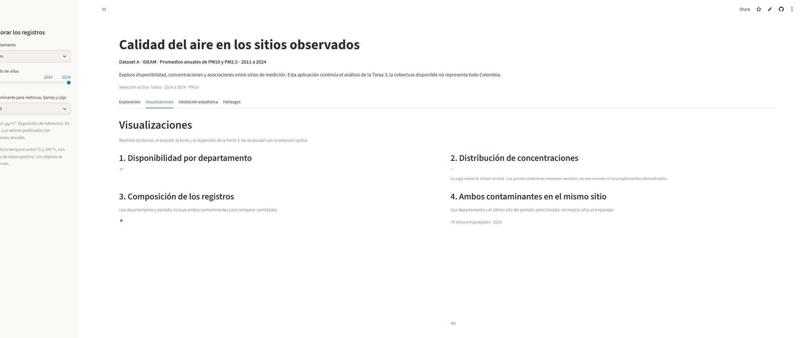

# Calidad del aire en los sitios observados · IDEAM

Este proyecto comunica el análisis exploratorio de la Tarea 3 mediante un dashboard en Streamlit. Utiliza **Dataset A: Calidad del Aire en Colombia, Promedio Anual**, publicado por el IDEAM, en la copia conservada `DatasetA_IDEAM_2026-10-01.csv`. El periodo disponible es 2011 a 2024. El propósito es explorar disponibilidad, concentraciones y asociaciones entre sitios sin interpretar los resultados como una muestra representativa de Colombia.

Conservo las 29.683 filas y 28 columnas del CSV original. La metodología documentada cuenta una representación por equivalencia en todas las columnas y obtiene 15.745 filas analíticas. Para PM10 y PM2.5 selecciono unidad `ugm3`, exposición de referencia de 24 horas, cobertura temporal de 75 a 100 % y número de datos positivo: quedan 1.665 registros anuales. El detalle está en `analisis.py`. Los resúmenes anuales no permiten reconstruir episodios diarios.

Los filtros de departamento y años actualizan la exploración. El selector de contaminante modifica las métricas, las barras y la caja; la composición incluye ambos contaminantes y la dispersión usa el último año seleccionado. La prueba de Welch y la narrativa conservan el alcance del EDA original y están identificadas como referencias fijas. El código fue desarrollado con asistencia de Codex y revisado con Gemini; las interacciones completas se conservan en el notebook académico, fuera de este repositorio.

## Aplicación

**Dashboard público:** [Abrir la aplicación](https://unad-t4-miguel-villabon-calidad-aire.streamlit.app/). Publicación, filtros y gráficos verificados por Codex el 15 de noviembre de 2026.

## Captura auténtica

Captura nativa de la aplicación pública, revisada abriendo el archivo guardado el 15 de noviembre de 2026. Las barras y la caja están completas; solo se recortó el margen exterior. Las otras cinco capturas se conservan en `imagenes/` y están incrustadas en el notebook académico.

## Hallazgos del EDA

- En 2024 se retienen 217 registros: 116 de PM10 y 101 de PM2.5.
- En 74 sitios emparejados de 2024, la correlación es 0,817702. Es asociación entre sitios, sin demostrar causalidad ni capacidad predictiva.
- En PM2.5 de 2024, las medias de los sitios observados de Antioquia y Cundinamarca son 18,053 y 12,844 µg/m³ (24 y 22 registros). Welch bilateral produce p = 0,0000647452, condicionado a sus supuestos.
- En cinco sitios constantes de PM10, cuatro de Bogotá y uno de Cesar, la media pasa de 52,90 µg/m³ en 2011 a 30,35 en 2024, con repuntes intermedios. No es una tendencia nacional.
- En el subconjunto completo de 2024, la regla IQR identifica cinco atípicos de PM10 y tres de PM2.5; se conservan porque no se han demostrado errores.

## Instalación y ejecución local

Requiere Python 3.12. Abre una terminal dentro de la carpeta descargada del proyecto.

1. Descarga el repositorio mediante **Code > Download ZIP** y extrae su contenido, o clónalo con Git.
2. Crea un entorno: `python -m venv .venv`.
3. Actívalo en Windows PowerShell: `.\.venv\Scripts\Activate.ps1`. En macOS/Linux: `source .venv/bin/activate`.
4. Instala las dependencias: `python -m pip install -r requirements.txt`.
5. Ejecuta: `python -m streamlit run app.py`.
6. Abre la dirección que indique Streamlit, normalmente `http://localhost:8501`.
7. Cambia departamento, años y contaminante. Un solo registro muestra desviación no estimable; una selección vacía informa la ausencia de datos.

El archivo se carga respecto a la ubicación del código; no requiere rutas personales. La huella SHA256 de la copia conservada es `4f58cf846a3575efb409af08a1b6b20d6e47ab4777b2c6915e28450899138606`. Se verifica para preservar la reproducibilidad frente a cambios de la fuente.

## Publicación

En Streamlit Community Cloud, selecciona este repositorio, la rama `main` y el archivo `app.py`. En la configuración avanzada elige Python 3.12 e instala las dependencias de `requirements.txt`. Comprueba carga, filtros, métricas, gráficos, validación y hallazgos antes de compartir la dirección pública.

## Fuentes y herramientas

- IDEAM. (s. f.). *Calidad del aire en Colombia: Promedio anual* [Conjunto de datos]. [Datos Abiertos Colombia](https://www.datos.gov.co/d/kekd-7v7h). Copia conservada: 1 de octubre de 2026.
- Streamlit. (s. f.). [Documentación de caché](https://docs.streamlit.io/develop/api-reference/caching-and-state/st.cache_data) y [publicación](https://docs.streamlit.io/deploy/streamlit-community-cloud/deploy-your-app/deploy).
- SciPy community. (s. f.). [ttest_ind](https://docs.scipy.org/doc/scipy/reference/generated/scipy.stats.ttest_ind.html).
- pandas contributors. (s. f.). [DataFrame.corr](https://pandas.pydata.org/docs/reference/api/pandas.DataFrame.corr.html).

**Miguel Angel Villabon Romero · Grupo 47**  
Programación para el análisis de datos · Código 203008069  
Especialización en Ciencia de Datos y Analítica · Universidad Nacional Abierta y a Distancia  
Noviembre de 2026
